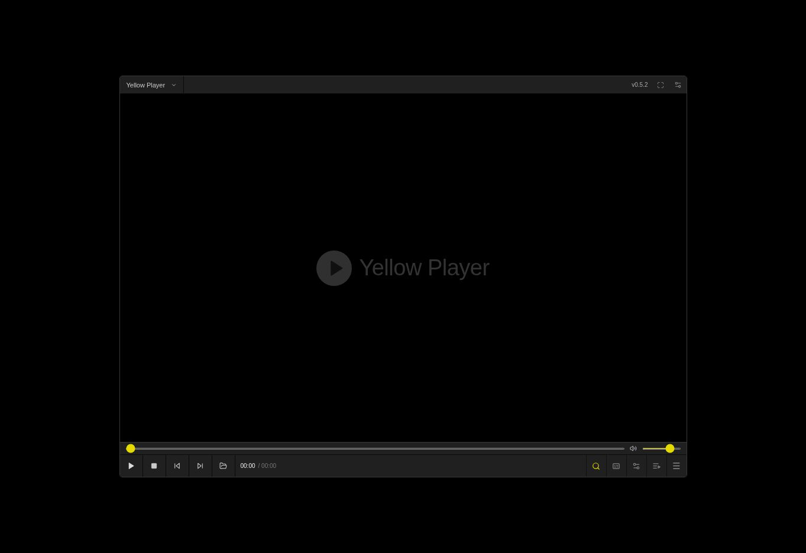
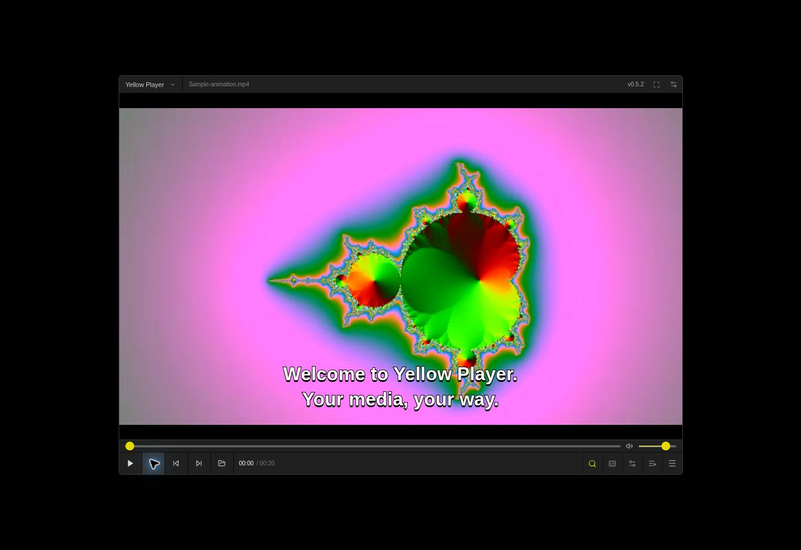
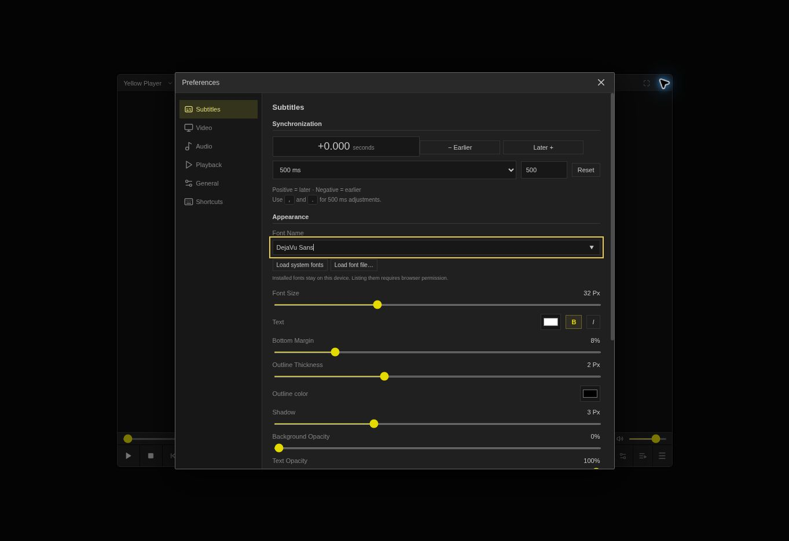
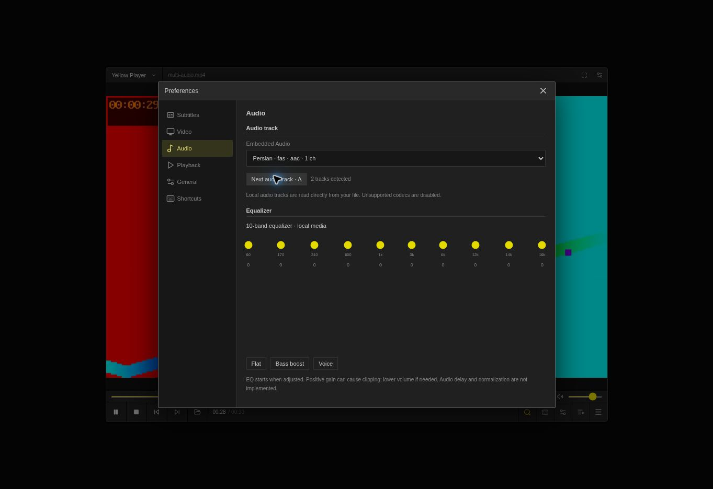

# Yellow Player

**[▶ Try Yellow Player Online — Live Demo](https://namak1.github.io/Yellow-Player/)**

Open the browser-based player directly to explore and test it—no installation required.

> **About this project:** Yellow Player is an independent media player inspired by popular players such as PotPlayer and KMPlayer. It is **not reverse-engineered** from those applications, does not use their proprietary source code, and is not affiliated with their developers.

A real local-first React/TypeScript media player with an original graphite-and-yellow interface. **Version 0.6.3 is an early working web release, not full PotPlayer parity.**

## Screenshots

Screenshots from working web builds, using generated test media.

### Player idle



### English subtitles



### Subtitle fonts and synchronization



### Audio tracks and equalizer



## Run

The download includes a prebuilt `dist/`. On macOS with Python 3 installed, run `python3 scripts/serve.py` (or the included `Start-Yellow-Player.command`) to open the player locally without npm installation. Keep the terminal open. This starts the web edition, not the experimental native engine.

Requires Node.js 22+.

```sh
npm ci
npm run dev
```

For a production build:

```sh
npm run build
npm test
npm run preview
```

Alternatively, serve the included `dist/` directory with a local HTTP server (`python3 -m http.server 8080 --directory dist`). Do not open index.html with file://. No media is uploaded. Opening a remote URL contacts its server.

## Included

- Local video/audio files and drag/drop, playlist ordering/search/removal, URL playback when browser/server permit it.
- Play/pause/stop, seek, volume/mute, speed/pitch preservation, fullscreen, repeat and A–B interval loop.
- Embedded audio-track selector under Audio → Audio track; A cycles supported tracks. Local files use native browser tracks or independent WebCodecs decoding over HTTPS/localhost. Unsupported codecs are disabled. Independent decoding changes pitch with playback speed.
- Searchable system-font picker (browser permission required where supported), manual installed-font names and font-file import.
- Subtitle cue editor with SRT export, sync-to-current-line and two-point drift correction.
- Nested desktop-style player menus, go-to-time and media information.
- Automatic local MKV embedded SRT/ASS/SSA/WebVTT and MP4 tx3g/WebVTT extraction, track selection, and MKV attached fonts for original ASS rendering. PGS and VobSub bitmap subtitles are supported in MKV, plus external `.sup` and paired `.idx`/`.sub` files. Encrypted/compressed tracks remain unsupported. Extraction reads bounded chunks on your device.
- Vivid colors by default, unfiltered Original profile and persistent color adjustments under Preferences → Video. Vivid is a contrast/saturation preference, not calibrated PotPlayer or HDR parity.
- Fullscreen playback bar appears at the bottom hover area and for keyboard focus; touch devices keep controls visible. Browser fullscreen falls back to filling the window if unavailable.
- The loaded version is visible in the title bar. Online reloads request fresh HTML; complete service-worker updates activate without waiting for other tabs to close. Open media is not automatically reloaded.
- Legacy Persian sentence periods stored before the first word are normalized for display in text and ASS, without changing subtitle exports.
- Per-line Persian/Arabic RTL punctuation, mixed English lines and an explicit text-direction setting; display corrections also apply to ASS without changing exported cues.
- Real installed font weights without synthetic bold/italic; crisp subtitle shadow; pure black letterbox/background.
- SRT/VTT and ASS/SSA. Original ASS styling through libass/WASM; optional customizable text fallback. Secondary track is text-mode.
- Subtitle family/custom font, size, bold/italic, color, outline, shadow, background, opacity, alignment, margin and RTL text.
- Delay controls with 100/500/1000 ms or custom increments; offset stored per media/track. Positive means later.
- Cue browser, bookmarks, resume metadata, recent history, persistent preferences.
- Previous/next frame: `<` / `>` (pauses playback). Ctrl + mouse wheel zooms from 50% to 300%. Cursor hides after 1.8 seconds of inactivity over playing video.
- Manual aspect presets, gamma, exposure, and Reinhard/Hable/ACES display curves under Preferences → Video. Advanced gamma/tone processing is explicitly opt-in and bypassed by default to preserve v0.5.6 colors. The Restore v0.5.6 colors button resets it. These controls process browser-decoded pixels; the browser retains control over HDR decoding/tone mapping. Source-peak and target-white controls cannot restore highlights already clipped by the browser.
- Audio delay from −10 to +10 seconds under Preferences → Audio. Positive delay uses Web Audio for browser audio; negative delay requires a locally decodable audio codec and uses synchronized independent decoding. Unsupported requests preserve playback and report the limitation.
- Bitmap subtitle timing and track selection are supported; bitmap font changes, OCR/text editing, DVD menu/high-definition SPU commands, encrypted/compressed streams, and palette fades are not implemented. External VobSub requires both matching files; individual SPUs are bounded to 1 MB, total bitmap input to 32 MB.
- Continuous buffered audio scheduling uses a single playback clock and corrects millisecond-rounded packet timestamps. Multichannel software audio uses an explicit stereo downmix with headroom to avoid clipping while retaining dialogue and surrounds (the dedicated LFE channel is omitted).
- Automatic software audio fallback for AC-3, E-AC-3, and DTS, including six-channel tracks in local MKV files. Decoder workers/WASM are bundled with the app and cached for offline use; no media upload or server conversion is involved. AAC/MP3/Opus/Vorbis/FLAC use available browser decoders, while PCM uses the built-in decoder. Universal audio codec coverage (including TrueHD/Atmos, WMA, ALAC, APE, encrypted tracks or every DTS-HD profile) is not guaranteed.
- Local-media 10-band equalizer and two presets; visual color adjustments, rotation, flip, zoom/fit/crop and frame capture.
- Dark/light themes, keyboard shortcuts, context menu, PWA manifest, generated offline asset cache.

## Important limits

Browser decoding is not FFmpeg-level coverage. MKV/HEVC and embedded track support vary; disc menus, online subtitle search/translation, recording, raw HDR decoding/interpolation and many native features are not implemented. Local frame stepping uses packet presentation timestamps; network streams use an approximate 30 fps fallback. Snapshot includes video color filters but excludes subtitle overlays/rotation/crop. Custom fonts apply to text mode and are session-only; original ASS uses bundled DejaVu Sans fallback. Media files are not retained across reloads; reopen the same files to resume. Playlist metadata export is not a playable saved-file grant.

Remote streams require CORS because the media element supports Web Audio. Equalizer UI is restricted to local media. CSS video transforms do not transform original ASS overlays; use default fit/rotation for styled ASS alignment.

Offline cache is built and its fetch logic unit-tested; airplane-mode browser reload has not yet been validated. Production asset cache does not cache media. Safari, Firefox, high-resolution and large-file testing remain outstanding.

## GitHub Pages

Repository: https://github.com/namak1/Yellow-Player. Source is published through the connected GitHub account.

The project is configured for the `main` branch. Enable **Settings → Pages → Build and deployment → GitHub Actions**. `.github/workflows/pages.yml` runs build/tests and deploys `dist/`. The intended URL is `https://namak1.github.io/Yellow-Player/`; deployment has been verified.

## Experimental macOS source

`src-tauri/` contains a Tauri 2 shell and constrained mpv Unix-socket bridge. On a Mac with Rust, Xcode command-line tools and separately installed mpv (`brew install mpv`):

```sh
npm ci
npm run native:dev
```

The **Native engine** button appears only in Tauri. It opens mpv's separate native video window and provides file/subtitle loading, playback, seek, speed, volume, subtitle delay/font/size and track cycling. This is **not embedded libmpv**. Native compilation, IPC operation, Apple Silicon decoding and packaging have **not been tested** on this Linux environment. No installer, signing, notarization or native release is provided. `macos.yml` is a manually triggered compile workflow, not a validated release pipeline.

## Research and status

See `docs/RESEARCH_SOURCES.md`, `docs/POTPLAYER_FEATURE_INVENTORY.md`, `docs/FEATURE_PARITY_MATRIX.md` and `docs/TESTING.md`. Research is a documented baseline with gaps, not an exhaustive reverse engineering of PotPlayer.

## Licensing

Original application code: MIT. PotPlayer is proprietary; no proprietary code/assets are included. Third-party notices are in `THIRD_PARTY_NOTICES.md` and `public/libass/`. mpv/FFmpeg are not bundled. Their licensing depends on exact build configuration and must be checked before native distribution.
